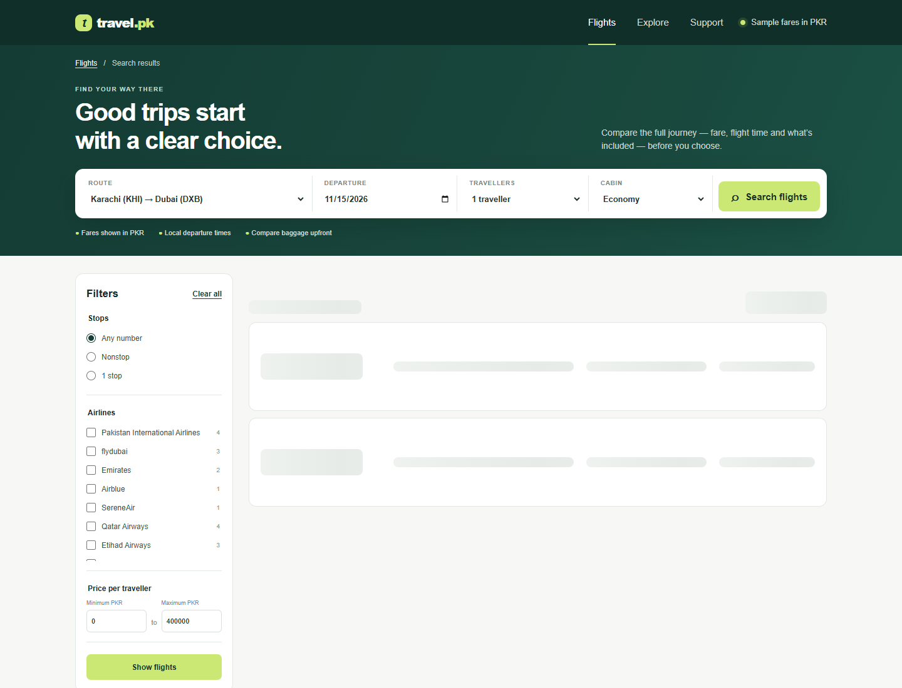
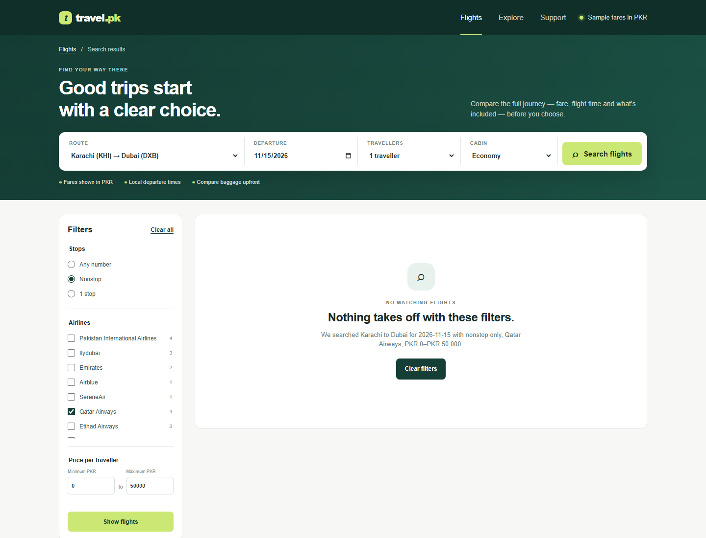
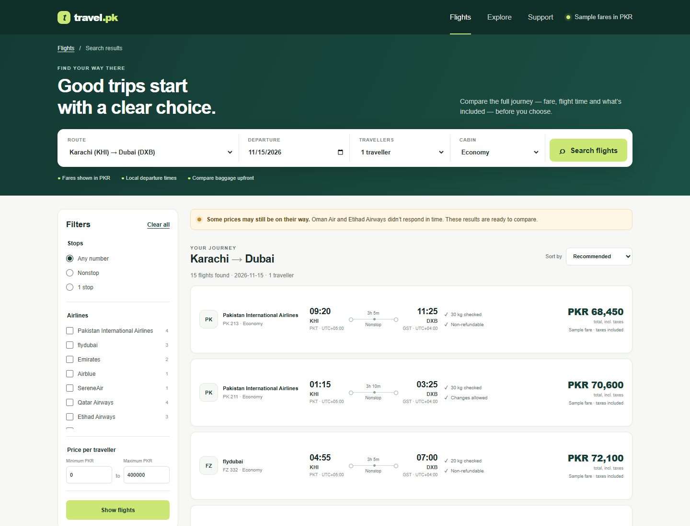
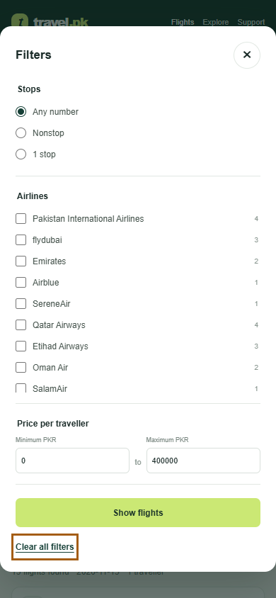

# Walkthrough and keyboard-only pass

## Four supplier states

Open a state from the URL directly (full URLs and the `simulate` contract are in [README.md](./README.md)). Each result screen keeps the same route/date/pax/cabin and waits behind a reserved-height loading skeleton.

1. **Loading:** open the `simulate=slow` URL. The result area shows “Checking flight results” skeleton cards while the 2.5-second supplier wait is running.
2. **Empty:** open `simulate=empty` for the deterministic no-offer screen. It names the search's active stop/airline/price filters and **Clear filters** returns to the same trip without them. The README also gives a filter combination that produces a no-match from the actual offer data.
3. **Error:** open `simulate=error` for a 503-style partner outage. **Retry search** retains trip, filters and sort while dropping the forced error flag.
4. **Partial:** open `simulate=partial` (the default) to see offers plus a non-blocking notice naming partners that did not respond. `simulate=ok` suppresses the notice for a healthy-response comparison.

## Keyboard-only pass

Start at the top of `/air/search` and use `Tab`, `Shift+Tab`, arrow keys for native selects/radios, `Space` to toggle checkboxes, and `Enter` to submit:

1. The skip link is first in the tab order. Tab through the header and search form; each input has a visible label and focus outline.
2. Tab to the desktop Stops/airline/price controls. Choose a stop radio, toggle one airline, change a price bound, then submit **Show flights**. The URL updates with those filters.
3. Tab to the Sort by select and choose another order. Confirm the `sort` parameter changes and browser back restores the prior URL/result order.
4. On a narrow viewport, tab to **Filters** and press Enter. The native modal dialog moves focus inside and contains it while open. Use `Tab`/`Shift+Tab`; `Escape` closes it and restores focus to the opener. Apply or clear from inside the dialog.
5. Tab through each result card; the flight list has an accessible name, fare buttons name the airline and amount, times expose their date-time with local UTC offsets, and result count changes use a polite status message.

The repeatable keyboard pass in `scripts/capture-walkthrough.mjs` uses only keyboard input for the page controls. At desktop width it tabs to the stop radios, selects Nonstop with an arrow key, checks PIA with Space, enters a price ceiling, submits with Enter, and changes sort from the native select. The script then exercises browser Back and confirms the URL-backed filters return. At 390px it tabs to **Filters**, opens with Enter, checks that Shift+Tab stays inside the dialog, and closes with Escape to confirm focus returns to the opener.

## Screenshots

Regenerate these with `npm run screenshots` while the app is running. The script uses local Chrome; set `CHROME_PATH` if its executable is elsewhere.

### Loading

### Empty results with active filters

### Supplier error and retry

### Partial supplier response

### Mobile dialog keyboard focus

